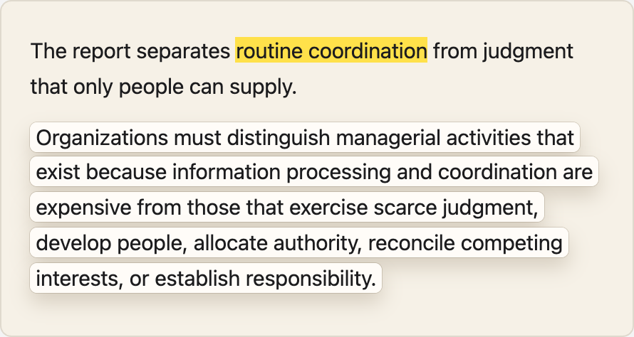
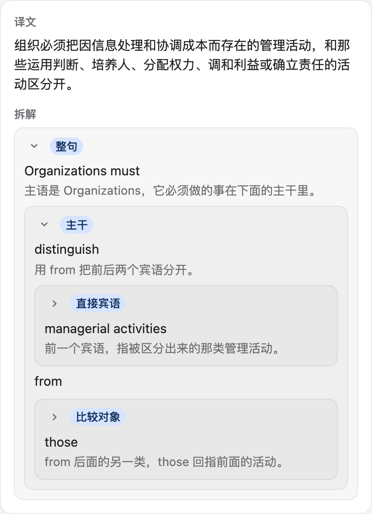

# 笔记展示、临时选区、完整语境与语法树

对应未关闭的 GitHub issue：[#25](https://github.com/hedon954/lumen-pdf/issues/25)、[#26](https://github.com/hedon954/lumen-pdf/issues/26)、[#27](https://github.com/hedon954/lumen-pdf/issues/27)、[#28](https://github.com/hedon954/lumen-pdf/issues/28)、[#29](https://github.com/hedon954/lumen-pdf/issues/29)。

## 问题

笔记面板把 Markdown 源码原样显示，`**`、`###`、`---` 都留在正文里。笔记一长，显示区域不滚动，后面的内容被截掉。

查单词时，原文语境会丢掉句首还在页面上的词。查 `responsible` 时，语境从 “management is responsible…” 开始，页面上的完整句子是 “Engineering management is responsible…”。中文语境也跟着缺了句首。

翻译时的临时选区和已经保存的高亮都是黄色，分不清哪一块只是当前选择、哪一块已经写入标注。

长句的语法分析把句子切成编号并列的片段。从句和修饰成分与主干的从属关系被拆开，读起来像一串互不隶属的条目。选区常常只覆盖半个词或半句，分析却按这段残缺文本来做。

## 用户行为

### 笔记怎么读、怎么改

- 阅读 Inspector、原文回顾浮窗、笔记列表里，未在编辑的笔记按 Markdown 显示：`**文本**` 为加粗，`### 标题` 为对应级别的标题，`---` 为分隔线。
- 笔记正文可以滚到末尾。长笔记不被行数上限截断。
- 点进某条笔记仍直接改原文并自动保存。正在输入时看到的是 Markdown 源码，不在键入过程中做实时预览。按 `Esc`、点「完成」或离开编辑后回到渲染结果。
- 新建笔记的输入框仍是源码，空内容不能提交。

### 查词要带上完整原句

- 原文语境是选中词所在的那一句，从句首到句末，不丢字。
- 一句被排版拆到下一行、行末用连字符断开、或写在同一栏里时，仍然是一句。下一句、另一栏、以及和正文隔开的标题不接进来。
- `Mr.`、小数点这种句号不把句子截断。
- 中文语境译文基于这句完整原文。
- 句首是大写专名、句首已被高亮、句首和后文分处两行、目标词是第二个词时，句首仍然在。

### 临时选区要和已保存高亮分开

- 打开翻译时，只给用户实际选中的文字铺一层亮黄色圆角标牌，底下有柔和投影，整块像 macOS 预览查询一样从纸面浮起来，文字清晰可读且不被底下的已保存高亮混色干扰。
- 不把语境那一整句涂到页面上。
- 已保存高亮保持原来的贴纸平铺黄色，并继续写在标注里。
- 关掉翻译后，临时标记消失，不写入 PDF。

### 选得不全时先补全

- 句子翻译和语法分析不使用残缺选区。半个词先补成页面上的那个词，半句补成它所在的整句，然后再分析这一整句。
- 已经是一个完整单词时，查词就用这个词，不会改成旁边更长的词。只有选区停在词的中间时，才补成这一行上的那个词。
- 语境是包含这个词的那一句，按整词匹配。`observation` 不会因为上一句有 `observations` 就改用上一句。后续修订：选区已经覆盖一整句时，不再因为「句子从选中词开头」或「句子和选区差不多长」把相邻句并进来，见 [prd-2026-11-26-selection-span.md](prd-2026-11-26-selection-span.md)。

### 长句语法按递归结构一次展开

- 语法是一棵树。先看补全后的整句由哪些部分组成，再看每个部分自己的结构。从句或子部分如果仍是复杂结构，就用同样的方式继续往下拆。简单部分停住，不再往下拆。
- 词按阅读顺序只出现一次。外层框住内层，角色写在框上。`Organizations must` 在整句里，`distinguish` 在主干里，两个宾语再框在主干里，`from` 留在两个宾语之间。
- 每一层在自己的词下面用一句话说明它在上一层里起什么作用。收起时这句话还在，只隐藏里面的框。
- 有子层的节点用一个展开按钮收起和展开，按钮上不写「展开」「收起」。
- 打开时先展开整句和主干，更深的从句收着，避免一层套一层把浮窗撑满。
- 宾语自己还有从句时，从句框在这个宾语里面，不再另开一块图。
- 不把同一段原文在每一层重贴，也不另造甲、乙、丙，不使用 1、2、3。
- 从句之间只起连接作用的标点，以及单独的 and / or / but，不单独占一行。
- 整句译文仍在译文区。短句、简单句仍然只有译文，不出现拆解。

## 非目标

- 不改笔记的存储格式，不把语法树写进笔记。
- 导出笔记仍导出 Markdown 源码。
- 不改变已保存高亮的颜色、合并规则和撤销。
- 不改单词模式的释义结构，也不为某一个词写特例。
- 不指定临时选区的具体颜色、阴影或动画数值。

## 验收

1. 一条含 `**加粗**`、`### 标题` 和 `---` 的长笔记，在 Inspector、回顾浮窗和笔记列表里都能看到格式，并能滚到最后一句。点进去修改，停顿后仍自动保存；再离开后看到的是渲染结果。
2. 用 “Engineering management is responsible not only for what the organization produces, but for the engineering capability the organization becomes.” 查 `responsible`，原文语境和中文语境都包含句首的 Engineering。句首大写专名、句首已被高亮、句首与后文分开、目标词是第二个词时，也不丢句首。
3. 同一行上既有已保存的黄色高亮，又打开翻译时，临时选区能一眼看出是浮起的当前选择。关闭翻译后只剩已保存高亮。
4. 只选中半句或半个词时，分析对象补全成页面上的整句，页面上的临时标记仍只盖在用户选中的字上。`distinguish ... from ...` 打开时能看见整句和主干，两个宾语先收着，每一层都有一句作用说明。点宾语旁的尖角才看见里面的从句。每个词只出现一次。短句不出现拆解。
